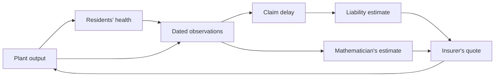

# P29: the town's mathematician — results

Codex (GPT-6), session `0c750220`, 2026-09-28. **Status: run of a proposed model.**
All four predictions in `P29-TOWN-PREDICTIONS-2026-09-28.md` held in their stated scope.
Eleven tests pass in four separately capped files (3 + 2 + 2 + 4). Final affected-file
runtimes: law 1.34 s, insurer 2.79 s, account 4.46 s; smoke 1.73 s, unaffected by the fix.
Each cap was 180 s; report cap 60 s, all completed well within it. No parameter search.

## What the run answers

A town made of ordinary Arrangement objects can compose a profit-seeking plant, harmed
residents, delayed liability assessment, an insurer, and a learner of the harm. The learner
sends her fitted coefficient forward; the insurer uses it in its quoted premium schedule;
the plant's ascent of current expected profit then changes its production. No backward
health covector was secretly added to the plant, and no report directly changes a balance.
The causal route is checked by disconnecting her report: all preexisting coordinates then
reproduce the historical-insurance town.

David specified the objective: “it's trying to maximize profits.” The realization here is
Codex's: ascent of **current expected operating profit**, not solving an intertemporal
optimal-control problem. Revenue is linear in output; production cost and the premium
schedule are quadratic. The insurer chooses a coefficient, and the plant knows the
schedule's marginal price. Harm is valued one-for-one in money for this model.

The insurer reads either the historical estimate or her estimate, as specified by the stage.
The diagram shows information. Separate balanced records carry premiums, claims, and the
external operating surplus. The court's payout does not manufacture a reverse gradient.

## Measurements

Dimensionless model, benefit 1, harm coefficient 2, recovery 1, dt .02, six-unit claim delay,
30-unit horizon. Initial output .1, illness zero, unknown estimates zero, initial money zero.
The learning rate is 40 and the quote rate 2. “Prompt law” keeps the one-step observation
latency but removes the court delay. “Informed” starts with the true coefficient; all actual
payments are still delayed. Harm is cumulative incident illness, not final illness burden.

| Scenario | Cumulative harm | Peak output | Operating surplus |
| --- | ---: | ---: | ---: |
| No return route | 28.609091 | 1.000000 | 14.795455 |
| Law, prompt evidence | 3.855612 | 0.580204 | 8.734619 |
| Law, delayed evidence | 8.345398 | 0.998156 | 9.813248 |
| Law, informed plant | 3.290836 | 0.333333 | 8.276804 |
| Insurance, past claims | 8.681451 | 0.998372 | 9.920930 |
| Insurance, her account | 3.882234 | 0.657234 | 8.695075 |

Her account reduces cumulative harm against historical insurance by **55.2813%** at dt .02;
**55.1688%** at dt .01 with the same physical delay and horizon. This is a finite transient
comparison; both insured runs approach output 1/3 and continue causing harm. The prediction
was at least 10%, fixed before code. The percentage is not a universal insurance effect.

Her estimate crosses half the true coefficient at t=1.10, her insurer's quote at t=1.56;
the first claim is paid at t=6.04. The historical insurer's quote crosses half at t=7.48.
The informed plant reduces output early despite late payment. Thus **late knowledge matters
here; late payment alone does not force late action**. Information gathering and institutional
uptake are prerequisites, not results of the run.

## What each test establishes

1. `test_town_smoke.py`: production matches its closed-form scalar recurrence and is
independent of the harm coefficient. At output .7 the actual composite's health/output
cross-partial mismatch is 1.4; an ordinary finite difference agrees. Phi reproduces product
integrator stepping. Non-exactness excludes a potential for this forcing, not every scalar
Lyapunov function or every possible sense of a common good.
2. `test_town_law.py`: dated samples traverse the exact discrete register delay with no
early arrival. Delayed evidence raises harm and peak output versus prompt evidence. The
informed estimator remains exactly at the true coefficient and production follows its
analytic priced recurrence. Payment transfers balance at every step. Overshoot means peak
output above the correctly priced steady output, not demonstrated oscillatory instability.
3. `test_town_insurance.py`: the quote follows the specified geometric smoothing response
and lags its only evidence. Actual premium receipts minus claims equal changes in the fund.
The earlier insurance test's quarter-turn oscillator is a different construction and is not
evidence for this delay result. Adding historical insurance does not improve on law alone
in this run: its additional quotation lag raises harm from 8.3454 to 8.6815.
4. `test_town_account.py`: early forecast and the harm reduction survive step halving;
disconnecting her account reproduces all preexisting coordinates; identical nonzero
observations with different hidden coefficients give identical nonzero learning forces.
No exposure freezes a wrong fit. An exact downstream reader pulls on her fit, whereas the
specified one-way reader does not. The library uses ordinary derivatives throughout;
one-way boundaries are explicit zero input components of the one-form.

The no-exposure check establishes **possible** stale learning. The successful town retains
positive exposure and one identifiable coefficient; it does not show that settling makes
this particular estimate stale. The program receives the wiring; it does not discover a
lawsuit or insurer, and the Jacobian diagnostic is run by the tester, not by an autonomous
mathematician agent. Understanding a book remains outside the construction.

## Money and limits

Historical insurer: final cash -5.24453, incurred but unpaid claims .668889, cash less those
claims -5.91342. With her account: final cash +.143891, unpaid claims .672598, cash less
claims **-.528707**. Credit is unlimited in both. Positive cash is not solvency, and the
run cannot support a survival-under-risk claim. All money identities include the explicitly
external operating surplus; the model does not include its buyers and suppliers as boxes.

**Reasonable or weird** (Codex's judgment, not empirical evidence): an estimate from recent
health observations can change a quoted price before a court pays, and a plant can respond
through expected profit. Artificial: perfect health measurements, known recovery, one unknown
coefficient, automatic acceptance of her account, all harm covered, a quadratic premium
schedule, no competing insurers, coverage exclusions, capital requirement or default. The
historical insurer's debt is the direct consequence of initially free coverage and unlimited
credit. Earlier action reduces both harm and operating surplus, so reduced harm alone does
not establish higher welfare. No general legal or epidemiological claim is made. At body or
cell scale the delay/observation/feedback pattern may be analogous; courts and money have
no biological counterpart claimed by this run.

## Approved book placement and phrase-to-mathematics check

Chapter 1, **Can we articulate forms that matter?** (the section formerly titled **Accounting for work at every scale**): her account changes a price used by a
profit-seeking plant, making a later liability enter its present decision. Chapter 5,
**running a plan / the town construction**: the actual boxes, derivative diagnostic, delay,
balanced records, disconnected-account check and informed-plant control. Keep the information
advantage explicit. The example earns its place by showing the whole composite and a causal
ablation, rather than restating that pollution is an externality. Placement was proposed by
Codex from the run and approved by David, 2026-09-28, “yes” to placement and commits in both
repositories. No book prose was drafted.

| Phrase | Actual mathematical object |
| --- | --- |
| Production / illness burden / fitted coefficient | Separate state coordinates |
| Plant's expected profit | Negative of its conditional cost, with the quote held fixed |
| Response to a higher quoted coefficient | Change in its own forcing; the integrator remains fixed |
| Her account | Published fitted coefficient routed as forward data |
| Insurer uses her account | Target in the insurer's own prediction cost |
| Delayed claim | A dated record shifted through a fixed-length register chain |
| Insurer's money | Accumulated premium receipts minus settled claims |
| Missing return push | Specified zero input covector and nonzero cross-partial mismatch |

## Reproduction and implementation correction

From the library root, run each file separately:
`env PYTEST_ADDOPTS=-s scripts/run_tests.sh 180 tests/test_town_smoke.py`
and similarly law, insurance, account. `timeout 60 .venv/bin/python -u scripts/town_report.py`
regenerates `notes/P29-TOWN-MEASUREMENTS.json` with x64, matching the tests.

An initialization bug treated the absence of a first observation as a zero-harm observation.
It was corrected before final reporting: memory now includes an initially zero availability
coordinate. The informed-plant control checks that no phantom sample changes its estimate.
The first report used float32; its replacement explicitly enables x64. No predictions were
changed after seeing results. The original design remains intact with this implementation
clarification appended. The book's `notes/P29-RUNNING-LOG.md` retains the full recovery history.
